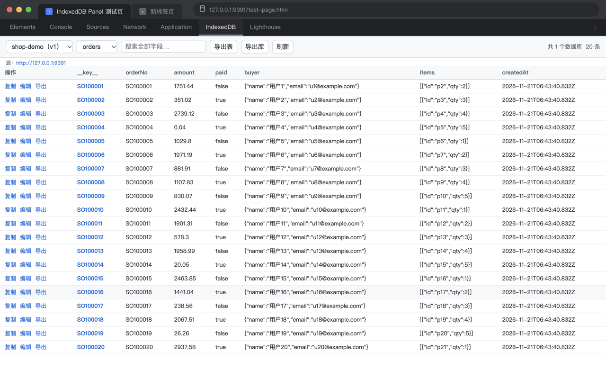
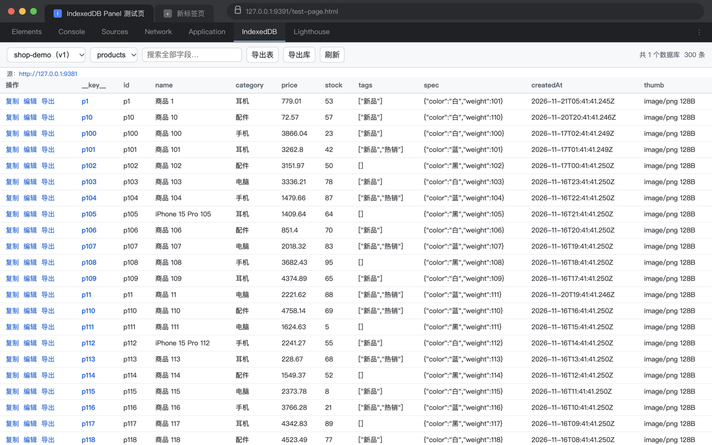
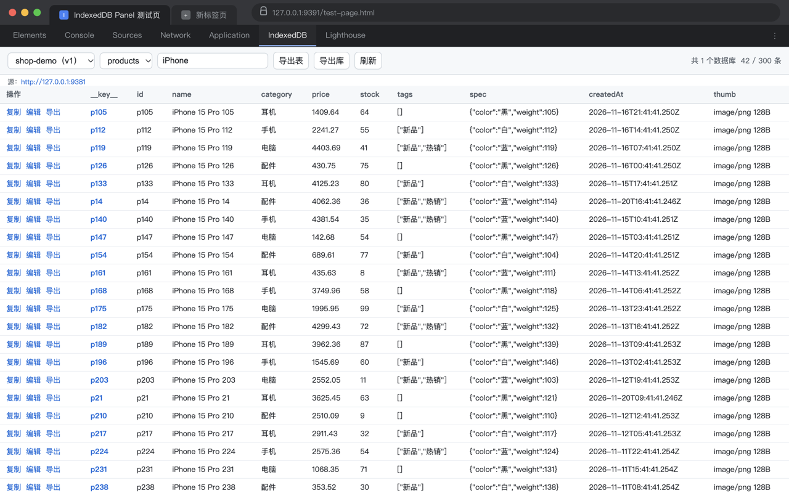
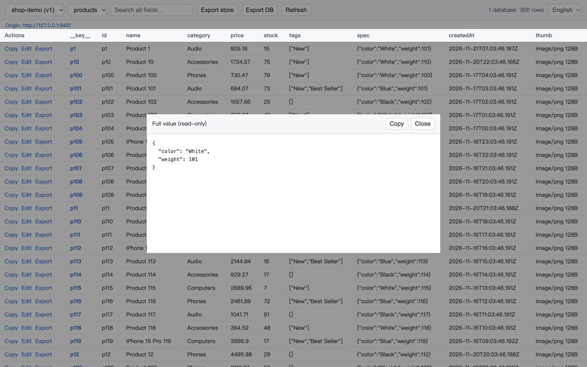
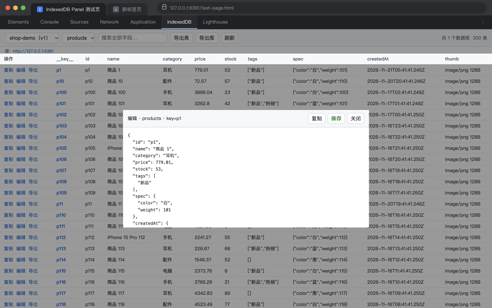

# chrome-indexDB-viewer

A Chrome DevTools extension that adds an **IndexedDB** panel to DevTools, letting you browse, search, edit, and export the inspected page's IndexedDB data as a table.

  

## Screenshots



<sub>A new IndexedDB tab inside DevTools, showing the inspected page's data as a table.</sub>



<sub>Table view: database/store pickers, keyword search, per-row copy/edit/export.</sub>



<sub>Search: fuzzy match across all fields, with the hit/total count in the top-right.</sub>



<sub>Clicking any cell opens the full JSON, ready to copy.</sub>



<sub>Edit: tweak the whole record as JSON and save it straight back to the page's database.</sub>

> `docs/store/` holds the Chrome Web Store assets — five 1280×800 screenshots, the 128×128 store icon, and a 440×280 promo tile — ready to upload.
> Store copy (name, descriptions, single purpose, permission justification, privacy answers) is in [`docs/store/listing-en.md`](docs/store/listing-en.md), with a Chinese version in [`docs/store/listing-zh.md`](docs/store/listing-zh.md).
>
> Both the UI chrome and the sample data in these images are in English, which is what the international storefront shows. The extension itself still ships in Chinese and English.

## Why another IndexedDB viewer

Chrome's built-in Application → IndexedDB works, but:

- No cross-field keyword search — you drill down level by level
- You can't see all fields at once; long values need one-by-one expansion
- No way to copy or export a single record as JSON
- Editing means clicking cell by cell, and Date / nested objects are painful

This panel turns those into single clicks: a flat table view, keyword filtering, JSON edit-and-write-back, and one-click export.

## Features

| Feature | Description |
|---|---|
| DB / store switching | Two dropdowns list every database under the current origin (with version) and every object store |
| Table view | Columns are inferred from records (sampled from the first 50, up to 15 columns); key column highlighted |
| Global search | Case-insensitive match against both **field names** and **field values** |
| Cell inspection | Click any cell for the full pretty-printed JSON (no more `ellipsis` truncation) |
| Row actions | Copy row JSON / edit and write back / export the row as `.json` |
| Write-back | Edit JSON in the modal; saving calls `objectStore.put()` on the page's database |
| Export store | Dump every record of the current store as JSON |
| Export database | Dump every store of the current database as one JSON file |
| Origin banner | Shows `location.origin` so you never inspect the wrong context |
| Chinese + English | Two built-in UI languages; follows the browser language by default, with a dropdown in the top bar to switch manually |

Rendering is capped at **200 rows** (`MAX_ROWS`); beyond that the panel asks you to narrow the search instead of freezing on a huge table.

## Install

1. Open `chrome://extensions/`
2. Enable "Developer mode" (top right)
3. Click "Load unpacked" and pick this repository root
4. Open any page → F12 → an **IndexedDB** tab appears in the DevTools tab bar (next to Console / Sources; it may be tucked under `»`)

> Requires Chrome 111+ (`indexedDB.databases()` plus MV3 DevTools panels). Verified on Chrome 157.

No build step: source is the artifact. After editing, hit ⟳ on the extension card and reopen DevTools.

### Packaging for the store

```bash
bash scripts/pack.sh
```

Produces `dist/chrome-index-db-viewer-<version>.zip`, ready to drag into the Chrome Web Store developer dashboard. The archive holds only runtime files plus `LICENSE` / `PRIVACY.md` / both READMEs; `test-page.html` (dev test page), `docs/` (store assets), and `scripts/` are excluded.

## Language

The UI ships with both Chinese and English (`i18n.js`) — no need to install two extensions:

- **Follows the browser language by default**: a Chinese browser gets Chinese, everything else gets English.
- **Language dropdown at the far right of the top bar**: a manual choice is saved in `localStorage` and reused next time.
- Switching only re-renders labels; already-loaded data is not fetched again.

The extension's name and description in the browser's extension list come from `chrome.i18n` (`_locales/en`, `_locales/zh_CN`), which Chrome also picks by browser language.

> The **data** shown in the table (database names, store names, field values) is displayed as-is and is never translated.

## Usage

1. In DevTools, make sure the execution context is the **page's own frame** (not the extension, and not an iframe unless that's where the data lives)
2. Pick a database, then a store — the table loads automatically
3. Type in the search box to filter; click a cell to inspect the full value
4. "Edit" → modify the JSON → "Save" writes it back; "Export store" / "Export DB" download JSON

The UI is currently Chinese-only.

### Type handling

Values are normalized (`norm()` in `panel.js`) before crossing `eval`:

| Original type | Shown in panel | On write-back |
|---|---|---|
| `Date` | `{"__t":"date","v":"<ISO>"}` | Revived as a `Date` |
| `Blob` | `{"__t":"blob","v":"image/png 128B"}` | **Cannot be revived** — becomes a placeholder object |
| `ArrayBuffer` / TypedArray | `{"__t":"buffer","v":"12 bytes"}` | **Cannot be revived** — becomes a placeholder object |
| Functions | `"[Function]"` | Kept as a string |
| Nesting deeper than 4 | `"[深层嵌套]"` | — |
| Arrays | First 200 elements only | — |

> Blob / binary payloads can't cross the JSON boundary into the DevTools panel, so only a summary is exported. **Editing and saving a record with Blob fields replaces them with a placeholder** — export a backup first.

## Testing

The repo ships `test-page.html`:

1. Open it in Chrome, click "创建测试数据" (create test data) — it builds the `shop-demo` database with 300 `products` + 20 `orders` (Date, Blob, nested objects, and array fields included)
2. F12 → IndexedDB panel → you should see `shop-demo（v1）` with `products` / `orders`
3. Searching `iphone` should leave ~42 rows (every 7th product)
4. Click a cell for full JSON; "编辑" a `stock` value, save, reload the page to verify

"清空数据库" deletes the database so you can start over.

## How it works

`chrome.devtools.inspectedWindow.eval()` **does not await Promises** — it only returns synchronously serializable values. Async reads therefore take three steps:

```
inject a kick script → the Promise's then-handler stores its result on window.__wb_idb_slot_<ts>_<seq>
                     → poll that slot every 60ms until done
                     → delete the slot after reading it
```

See `evalSync()` / `evalAsync()` in `panel.js`. Default timeout is 8s (15s for reading a store, 30s for a full-DB export); a page reload or navigation is detected as a missing slot and reported.

File responsibilities:

| File | Role |
|---|---|
| `manifest.json` | MV3 manifest with `default_locale: en`; `devtools_page` points at `devtools.html`; only permission is `clipboardWrite` |
| `devtools.html` / `devtools.js` | Does one thing: `chrome.devtools.panels.create(<title>, 'icons/icon16.png', 'panel.html')`; the title comes from `chrome.i18n` |
| `panel.html` | Panel UI and styles (no framework, no CDN) |
| `panel.js` | Panel logic: injected collect/write/export scripts + table rendering + modal interactions |
| `i18n.js` | Both UI dictionaries (Chinese/English) plus language detection and switching (`t()` / `setLang()`) |
| `_locales/{en,zh_CN}/messages.json` | Translations of the extension name, description and panel title, read by `chrome.i18n` |
| `test-page.html` | Local fixture page for generating test data |
| `icons/icon{16,48,128}.png` | Extension icons, also used as the DevTools panel icon |
| `docs/store/*.png` | Chrome Web Store assets: five 1280×800 screenshots + the 128×128 store icon + the 440×280 promo tile |
| `scripts/pack.sh` | Builds the store upload archive under `dist/` |
| `PRIVACY.md` | Privacy policy (Markdown, ships in the archive), usable as-is for the store listing |
| `docs/privacy.html` | Web version of the privacy policy — this is the URL to enter in the store dashboard |
| `docs/index.html` | GitHub Pages landing page linking the privacy page and the source |
| `LICENSE` | MIT license |

## Known limitations

- Only reads/writes the inspected page's current context; special origins like `chrome-extension://` and `devtools://` are unreachable
- Data inside an iframe requires switching the execution context manually (the panel does not enumerate frames)
- Uses `getAll()` with no cursor pagination, so a very large store (hundreds of thousands of rows) is slow on first load
- No object store creation/deletion, index maintenance, or key-range queries
- The page's own caches are not invalidated after a write-back; the page must re-read

## Contributing

1. Fork the repository
2. Create a `Feat_xxx` branch
3. Commit your code
4. Open a Pull Request

Code style: no build, no dependencies, plain ES2020 + native DOM. After touching `panel.js`, run `node --check panel.js`.

## Privacy

No data is collected or transmitted; there is no network request anywhere in the extension and the only permission is `clipboardWrite`. See [PRIVACY.md](PRIVACY.md); the web version (the URL to enter in the store dashboard) is <https://cy-osp.github.io/chrome-indexdb-viewer/privacy.html>.

## License

[MIT](LICENSE) © cy-open-source-project
