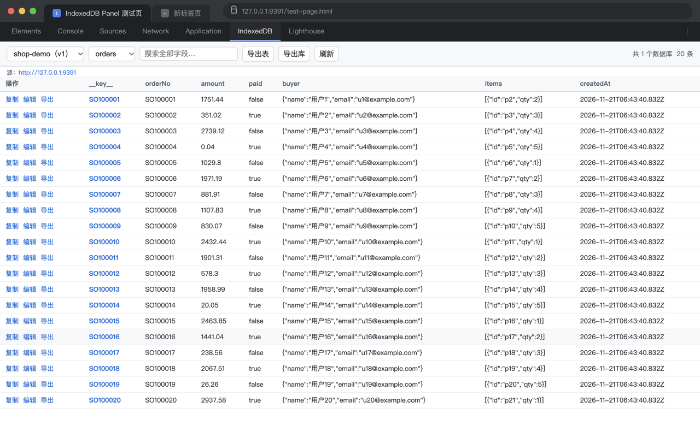
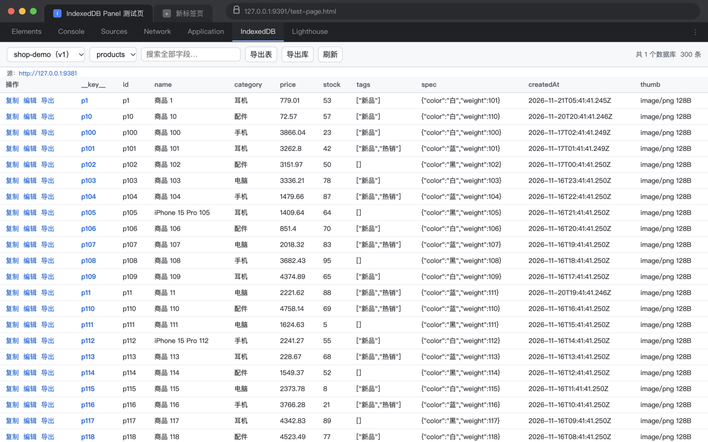
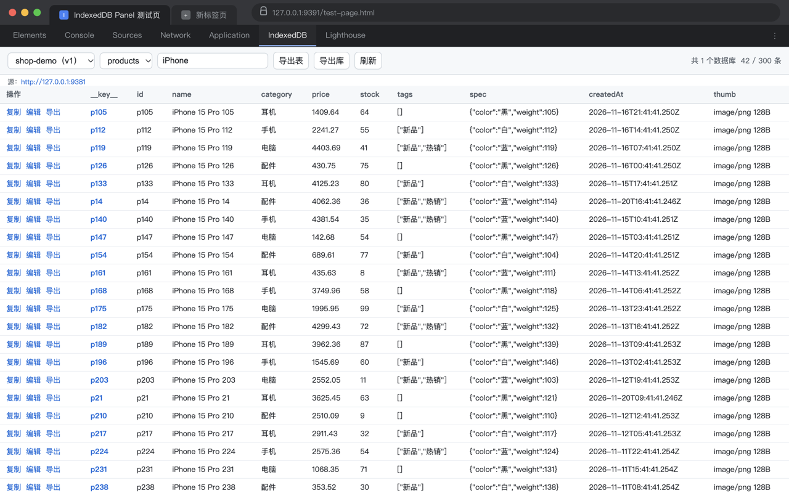
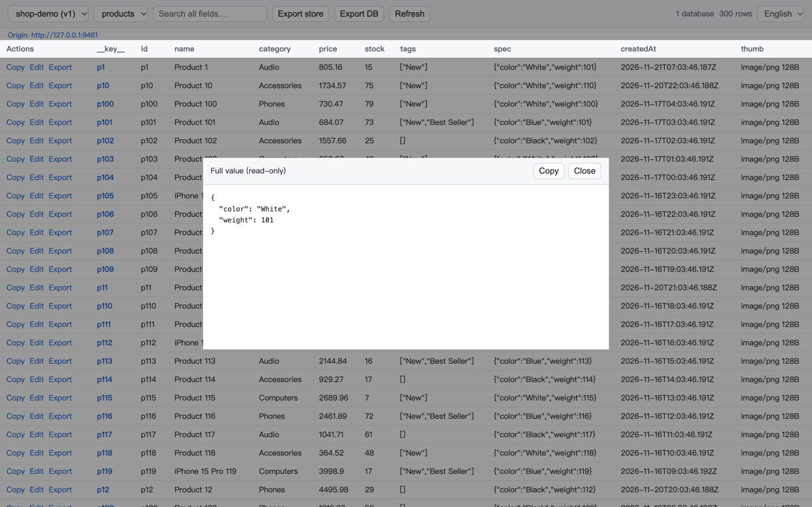
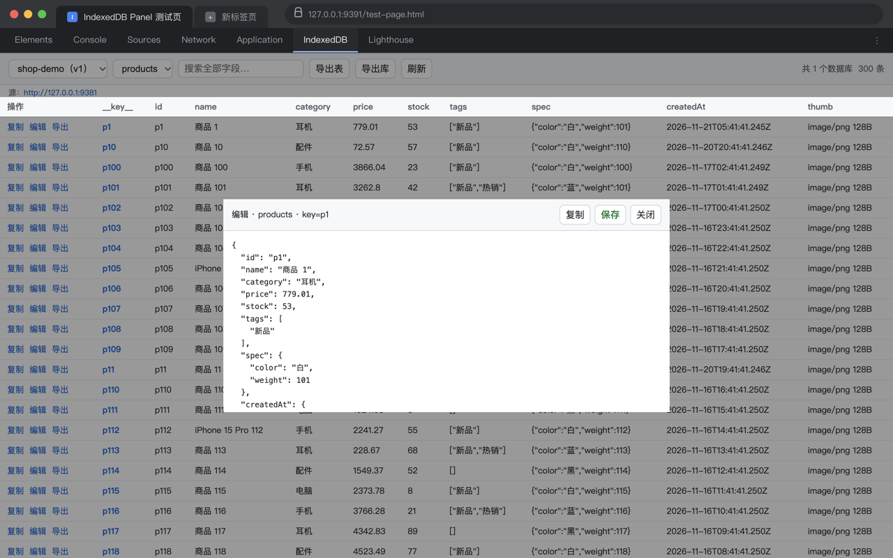

# chrome-indexDB-viewer

一个 Chrome DevTools 扩展：在 DevTools 里新增一个 **IndexedDB** 标签页，用表格的方式浏览、搜索、编辑、导出被检查页面的 IndexedDB 数据。

  

## 截图



<sub>在 DevTools 里新增一个 IndexedDB 标签页，表格化浏览被检查页面的数据。</sub>



<sub>表视图：顶部选库/选表、关键字搜索、行级复制/编辑/导出。</sub>



<sub>搜索：全部字段模糊匹配，右上角显示命中数 / 总数。</sub>



<sub>点任意单元格弹出完整 JSON，可复制。</sub>



<sub>编辑：整条记录当 JSON 改，保存即写回页面数据库。</sub>

> `docs/store/` 下是 Chrome Web Store 用的素材：5 张 1280×800 截图 + 128×128 商店图标 + 440×280 小型宣传图块，可直接上传。
> 商店文案（名称、简介、单一用途、权限说明、隐私问答）见 [`docs/store/listing-zh.md`](docs/store/listing-zh.md)（中文）与 [`docs/store/listing-en.md`](docs/store/listing-en.md)（英文）。
>
> 截图与宣传图块里的界面文案和示例数据都是英文（面向国际商店，避免评审看中文），扩展本身仍支持中英双语。
>
> 隐私政策的网页版由 GitHub Pages 托管：<https://cy-osp.github.io/chrome-indexdb-viewer/privacy.html>（源文件 `docs/privacy.html`，Pages 取自 `master` 分支的 `/docs` 目录）。商店后台的「隐私权政策网址」填这个地址。

## 为什么又多一个 IndexedDB 查看器

Chrome 自带的 Application → IndexedDB 已经能看数据，但：

- 不能按关键字全局搜索（只能一层层点开）
- 一次性看不到全部字段，长字段要逐条展开
- 不能直接把一条记录复制/导出成 JSON
- 改数据要手点每一格，Date / 嵌套对象来回折腾

这个面板把上面几件事变成一次点击：一条 SQL 式的表格视图 + 关键字过滤 + JSON 编辑写回 + 一键导出。

## 功能

| 能力 | 说明 |
|---|---|
| 数据库 / 表切换 | 顶部两个下拉，自动列出当前源下所有数据库（含版本号）与 object store |
| 表格视图 | 自动从记录里抽取字段当列（取前 50 条汇总，最多 15 列），主键列高亮 |
| 全局搜索 | 输入关键字，同时对**字段名**和**字段值**做不区分大小写的匹配 |
| 单元格查看 | 点任意单元格弹出完整格式化 JSON（不再被 `ellipsis` 截断） |
| 行级操作 | 复制该行 JSON / 编辑并写回 / 导出该行为 `.json` 文件 |
| 写回 | 详情弹窗里改 JSON，保存后直接 `objectStore.put()` 回页面数据库 |
| 导出表 | 当前 store 全部记录导出为 JSON |
| 导出库 | 当前数据库所有 store 一次性导出为 JSON |
| 源提示 | 顶栏显示 `location.origin`，避免看错上下文 |
| 中英双语 | 界面文案内置中英两套，默认跟随浏览器语言，顶栏下拉可手动切换并记住选择 |

单次渲染上限 **200 行**（`MAX_ROWS`），超出时提示用搜索缩小范围，避免超大表把面板卡死.

## 安装

1. 打开 `chrome://extensions/`
2. 右上角打开「开发者模式」
3. 点「加载已解压的扩展程序」，选择本仓库根目录
4. 打开任意网页 → F12 → 顶部标签栏会出现 **IndexedDB**（在 Console / Sources 一带，放不下时被收进 `»` 里）

> 需要 Chrome 111+（`indexedDB.databases()` 与 MV3 DevTools 面板）。已在 Chrome 157 上实测通过。

无需构建：源码即产物，改完文件在扩展页点一下刷新（⟳）再重开 DevTools 即可。

### 打包上传商店

```bash
bash scripts/pack.sh
```

产出 `dist/chrome-index-db-viewer-<version>.zip`，可直接拖到 Chrome Web Store 开发者后台。包里只有运行时文件加 `LICENSE` / `PRIVACY.md` / 两个 README；`test-page.html`（开发用测试页）、`docs/`（商店素材）、`scripts/` 都不进包。

## 语言 / Language

界面文案内置中英两套（`i18n.js`），无需安装两个扩展：

- **默认跟随浏览器语言**：中文浏览器进中文界面，其他语言进英文界面。
- **顶栏最右侧有语言下拉**：手动切换后选择记在 `localStorage`，下次打开沿用。
- 切换只改界面文案，已加载的数据不重新读取。

扩展在浏览器扩展列表里的名字和简介走 `chrome.i18n`，由 `_locales/en`、`_locales/zh_CN` 提供，同样按浏览器语言自动选。

> 面板里表格显示的**数据本身**（库名、表名、字段值）当然按原样显示，不会被翻译。

## 使用

1. 在 DevTools 里把执行上下文切到**页面本身的 frame**（不是扩展、不是 iframe，除非数据就在 iframe 里）
2. 选数据库 → 选表，表格自动加载
3. 搜索框输入关键字过滤；点单元格看完整值
4. 「编辑」→ 改 JSON → 「保存」写回；「导出表 / 导出库」下载 JSON

### 类型处理

页面里的值在跨 `eval` 传输前会被归一化（`panel.js` 里的 `norm()`）：

| 原类型 | 面板里看到 | 写回时 |
|---|---|---|
| `Date` | `{"__t":"date","v":"<ISO>"}` | 还原成 `Date` 对象 |
| `Blob` | `{"__t":"blob","v":"image/png 128B"}` | **无法还原**，写成占位对象 |
| `ArrayBuffer` / TypedArray | `{"__t":"buffer","v":"12 bytes"}` | **无法还原**，写成占位对象 |
| 函数 | `"[Function]"` | 原样作为字符串 |
| 嵌套超过 4 层 | `"[深层嵌套]"` | — |
| 数组 | 只取前 200 个元素 | — |

> Blob / 二进制数据无法通过 JSON 序列化传给 DevTools 面板，所以只导出摘要。**编辑并保存含 Blob 字段的记录会把该字段变成占位对象**，请先导出备份。

## 测试

仓库自带 `test-page.html`：

1. 用 Chrome 打开它，点「创建测试数据」→ 生成 `shop-demo` 库，`products` 300 条 + `orders` 20 条（含 Date、Blob、嵌套对象、数组字段）
2. F12 → IndexedDB 标签页 → 应能看到 `shop-demo（v1）`，表可切 `products` / `orders`
3. 搜索 `iphone` 应只剩 42 条左右（每 7 条一条 iPhone）
4. 点单元格看完整 JSON；点「编辑」改 `stock` 后保存，刷新页面读回验证

「清空数据库」按钮可删库重来。

## 实现要点

`chrome.devtools.inspectedWindow.eval()` **不会 await Promise**，只返回同步可序列化的值。所以异步取数据走三步：

```
注入 kick 脚本 → 把 Promise 的 then 结果挂到 window.__wb_idb_slot_<ts>_<seq>
                → 每 60ms 轮询该槽位直到 done
                → 读到结果后 delete 掉槽位
```

对应 `panel.js` 里的 `evalSync()` / `evalAsync()`。超时默认 8s（读表 15s、导出整库 30s）；页面刷新或跳转会检测到槽位丢失并给出提示。

文件职责：

| 文件 | 作用 |
|---|---|
| `manifest.json` | MV3 清单，`default_locale: en`，`devtools_page` 指向 `devtools.html`，权限仅 `clipboardWrite` |
| `devtools.html` / `devtools.js` | 唯一职责：`chrome.devtools.panels.create(<面板标题>, 'icons/icon16.png', 'panel.html')`；标题走 `chrome.i18n` |
| `panel.html` | 面板 UI 与样式（无框架、无外链 CDN） |
| `panel.js` | 面板逻辑：注入到页面的收集/写回/导出脚本 + 表格渲染 + 弹窗交互 |
| `i18n.js` | 面板界面文案的中英两套字典 + 语言判定/切换（`t()` / `setLang()`） |
| `_locales/{en,zh_CN}/messages.json` | 扩展名称、简介、面板标题的翻译，供 `chrome.i18n` 按浏览器语言取 |
| `test-page.html` | 本地测试页，造数据用 |
| `icons/icon{16,48,128}.png` | 扩展图标，同时用作 DevTools 面板图标 |
| `docs/store/*.png` | Chrome Web Store 素材：5 张 1280×800 截图 + 128×128 商店图标 + 440×280 宣传图块 |
| `scripts/pack.sh` | 打商店上传包，产出 `dist/*.zip` |
| `PRIVACY.md` | 隐私声明（Markdown 版，随包分发），商店后台填写隐私政策时可直接引用 |
| `docs/privacy.html` | 隐私声明的网页版，托管后作为商店后台填写的隐私政策网址 |
| `docs/index.html` | GitHub Pages 的落地页，指向隐私页与源码 |
| `LICENSE` | MIT 许可证 |

## 已知限制

- 只读 / 写被检查页面当前上下文的数据库；`chrome-extension://`、`devtools://` 等特殊源读不到
- 数据在 iframe 里时，需要在 Console 左上角的执行上下文里切到对应 frame（本面板不做自动枚举）
- 通过 `getAll()` 全量读取，没有游标分页；表特别大（数十万条）时首次加载会慢
- 不支持新建/删除 object store、索引维护、按 key 区间查询
- 写回后页面自身的缓存不会刷新，需要页面重新读取

## 参与贡献

1. Fork 本仓库
2. 新建 `Feat_xxx` 分支
3. 提交代码
4. 新建 Pull Request

代码风格：无构建、无依赖，纯 ES2020 + 原生 DOM；改动 `panel.js` 后请用 `node --check panel.js` 过一遍语法。

## 隐私

不收集、不上传任何数据，扩展里没有任何网络请求，权限只要了 `clipboardWrite`。完整说明见 [PRIVACY.md](PRIVACY.md)，网页版（商店后台填写的隐私政策网址即此）：<https://cy-osp.github.io/chrome-indexdb-viewer/privacy.html>。

## 许可证

[MIT](LICENSE) © cy-open-source-project
